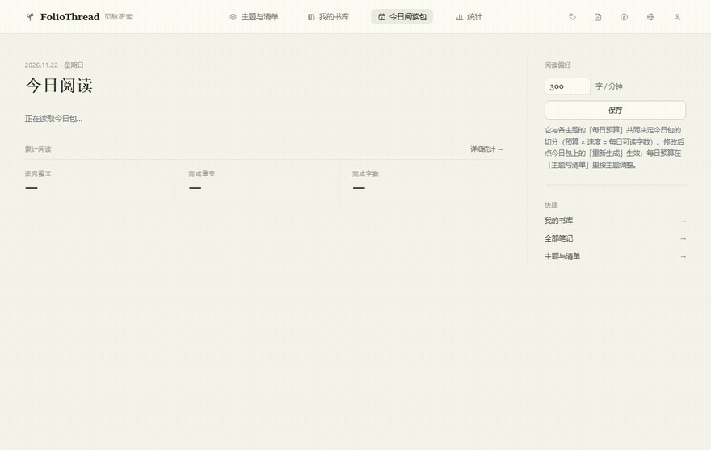

# FolioThread · 页脉研读

[English](README.en.md) · 简体中文

**一个为兴趣驱动的学习者设计的 AI 阅读规划工具：你提出一个想弄懂的主题，它替你排出由浅入深的书目，并把书拆成每天读得完的章节。**

> **这是一个自部署项目，没有官方托管版本。** 你需要准备自己的 Supabase 项目（以及可选的 DeepSeek Key），按下面的 Quick start 大约 5 分钟可以跑起来；书籍与笔记都留在你的项目里。

## 为什么做这个

面对一个陌生领域，最难的不是找书，而是不知道从哪读起、先读哪本、每天读多少。常见工具大多停在「记录」和「监督」——打卡、计时、统计——却很少回答「下一步读什么」。

FolioThread 想做那个向导：用 AI 生成带推荐理由的阅读清单，再把清单拆成可执行的每日份额，让系统性学习变得清晰、可持续。

## 核心特性

- **AI 阅读规划**：给出一个主题，AI 排出 5–6 本由浅入深、带推荐理由的书单；不满意可以用一句话调整，也可以只换其中一本。
- **私有书库**：应用不内置书城，书由你自己提供；清单里还没有 EPUB 的书会标为「待补充」。配置微信读书 API Key 后，这类书可以直接跳转到微信读书阅读。
- **专注阅读器**：按每日预算与阅读速度切出今天该读的章节；阅读器记录章节进度，并支持外文书籍按段 AI 翻译、与原文对照。
- **今日阅读包**：每天按预算重新切分剩余内容，已读完的章节自动跳过；跨零点换成新一天的包，直到整个清单读完。
- **可选听书**：整章朗读与背景音；语音链路为 Azure → 本机 edge-tts → 百度 → 浏览器内置。
- **中英双语**：界面、AI 输出与日期格式跟随界面语言。

## 演示

<p align="center">
  
  
  
</p>

从左到右：生成今日阅读包 · 一句话调整清单 · 阅读器听书（示例数据）。

## Quick start（约 5 分钟）

### 1. 建库（Supabase）

1. 新建一个 Supabase 项目。
2. 打开 **SQL Editor**，整段执行 [`database/init.sql`](database/init.sql)（等价于按 `0001`→`0009` 顺序执行迁移）。
3. 打开 **Storage**，新建一个 **私有** bucket，名字必须是 `shared`。
4. 打开 **Authentication → Providers → Email**，关闭 **Confirm email**（否则注册后无法直接登录）。

### 2. 配置环境变量

```bash
cp .env.example .env.local
```

至少填写这三项（Supabase Dashboard → Project Settings → API）：

```ini
NEXT_PUBLIC_SUPABASE_URL=
NEXT_PUBLIC_SUPABASE_ANON_KEY=
SUPABASE_SERVICE_ROLE_KEY=
```

其余变量都是可选的，缺失时应用会自动降级（见下文）。

### 3. 启动

```bash
npm ci
npm run dev
```

打开 <http://localhost:3000>，注册账号并创建第一个主题。

### 4. 自检

```bash
npm run doctor                      # 环境变量 + 13 张核心表
curl "localhost:3000/api/health?db=1"   # 页面运行后再查一次
```

`npm run doctor` 会明确告诉你缺哪个变量、缺哪张表；缺表时回到第 1 步执行 `init.sql`。

## Docker

> 这是可选路径：CI 会构建镜像并检查 `/api/health`（推送到 GitHub 后生效）。作者的日常部署不使用容器，见下方「本机部署」。

```bash
cp .env.example .env    # 填写三个必填项
docker compose up --build
```

说明：

- `NEXT_PUBLIC_*` 在构建期内联进客户端代码，**改了这两个值必须重新 build**。
- 容器健康检查调用 `/api/health`，环境变量缺失时会显示 unhealthy。
- 构建阶段由 `scripts/sync-audio.mjs` 自动生成 `public/audio/`，无需手动准备音频。

## 本机部署

```bash
npm ci
npm run build
npm start
```

服务监听 `3000` 端口。远程访问走 Tailscale 域名，手机浏览器添加到主屏后以独立窗口运行。该路径不产出 `.next/standalone`，因此构建比容器方式更快（见 `next.config.mjs`）。

## 可选集成（全部可缺省）

| 变量 | 缺失时的表现 |
| --- | --- |
| `DEEPSEEK_API_KEY` | 生成 / 重新生成清单直接返回 **503**，不用书库兜底；翻译与主题归类不可用；知识点静默失败 |
| `WEREAD_API_KEY` | 隐藏「微信读书可读」入口与标签 |
| `AZURE_SPEECH_KEY` / `AZURE_SPEECH_REGION` | 未配置则跳过 Azure；语音依次尝试 Azure → 本机 edge-tts → 百度，云端全部失败才回退浏览器内置语音 |
| `EDGE_TTS_PYTHON` | 手动指定 edge-tts 使用的 Python 路径；缺省自动探测 |
| `EDGE_TTS_DISABLED=1` | 禁用本机 edge-tts，跳过该档，仍会尝试 Azure / 百度 |

## 背景音乐（可选）

仓库不附带第三方音乐。听书模式的背景音按以下顺序取用：

1. `background-music/rain-loop.mp3`、`background-music/piano-loop.mp3`（自行放入，已被 `.gitignore` 忽略）；
2. 缺失时回落到 `assets/audio-fallback/` 下由 `scripts/make_audio.py` 生成的 CC0 合成音。

使用自己的音乐时，按这两个文件名放入 `background-music/` 即可，`npm run dev` / `npm run build` 会自动同步到 `public/audio`。作者本地使用的 Pixabay 曲目与许可说明见 [NOTICE](NOTICE)。

### 默认听到什么

**全新克隆 / 自部署默认听到的是 `assets/audio-fallback/` 里的 CC0 合成 loop**（滤波噪声模拟雨声、程序合成音符模拟钢琴），不是下面这两首真人录音。原因见 [NOTICE](NOTICE) 2.1：Pixabay 许可不允许把原始音频原样再分发，所以它们不进仓库，只存在于作者本机。

### 作者使用的音源（可选，自行下载）

想换成作者本地那两首，在 Pixabay 按 ID 搜索下载后按文件名放入 `background-music/`：

| 文件名 | 曲目 | 作者 | Pixabay ID |
| --- | --- | --- | --- |
| `piano-loop.mp3` | Gymnopédie No. 1 | Erik Satie（演奏：abydos_music） | 176573 |
| `rain-loop.mp3` | Sleep Well (Rainy Toasted White Noise Mix) | gingerleegalaxy | 229397 |

不放也完全可用，只是听到合成 loop；换不换不影响功能。曲目许可以 Pixabay 内容许可为准。

## 自带书籍

仓库**不包含任何书籍正文或封面**。导入的 EPUB 只写入你自己的 Supabase 项目与 Storage。支持界面导入，也可用：

```bash
npm run import -- ./path/to/book.epub
```

## 账户与删除

- 账户属于当前部署的 Supabase 项目，邮箱与密码由 Supabase Auth 管理。
- 顶栏右侧头像菜单 → Account 可查看登录邮箱，并删除整个账户；删除会一并清除该账号的书籍与 EPUB 文件、笔记、主题与清单、阅读进度，且无法恢复。
- 应用不提供管理员后台；部署者仍可在 Supabase 控制台手动删除用户。

## 已知限制

- 限流为进程内实现，只对单实例有效；多实例部署需要外部存储。
- 应用不提供数据库备份，备份与恢复由部署者负责。
- AI 生成的书单、翻译与知识点可能有误，请自行判断。

## License

代码以 MIT 发布，见 [LICENSE](LICENSE)。第三方背景音乐不入库，来源与许可见 [NOTICE](NOTICE)；仓库内的兜底音频由 `scripts/make_audio.py` 合成，以 CC0 发布。

版本记录见 [CHANGELOG.md](CHANGELOG.md)，安全问题报告方式见 [SECURITY.md](SECURITY.md)。
