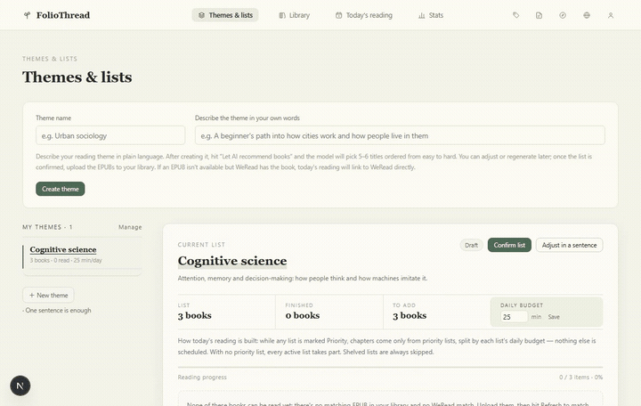
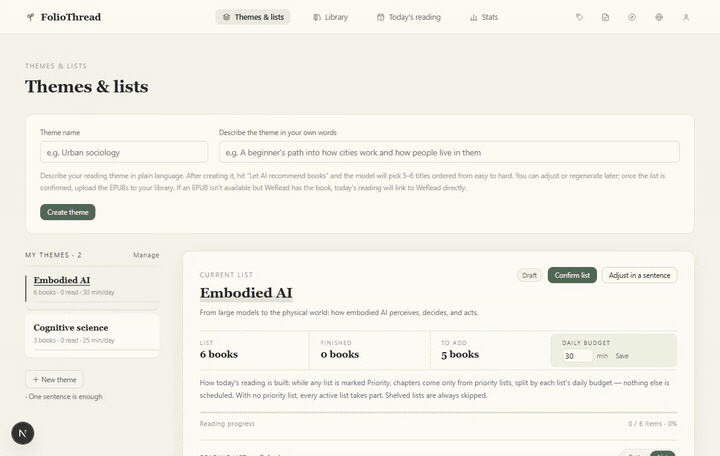
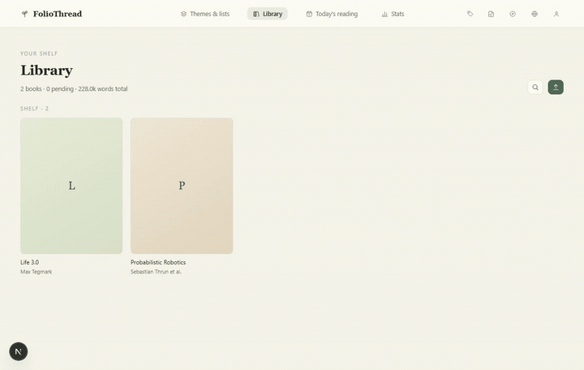
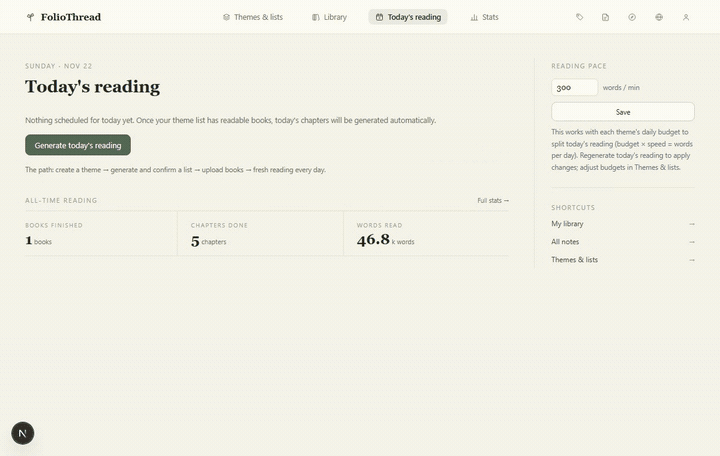
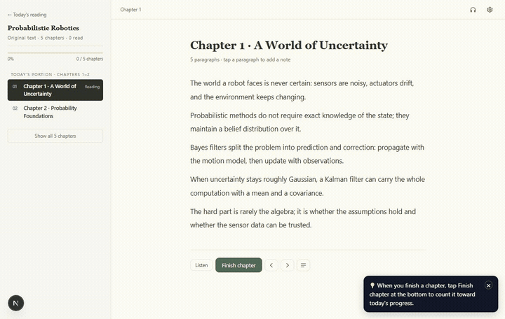
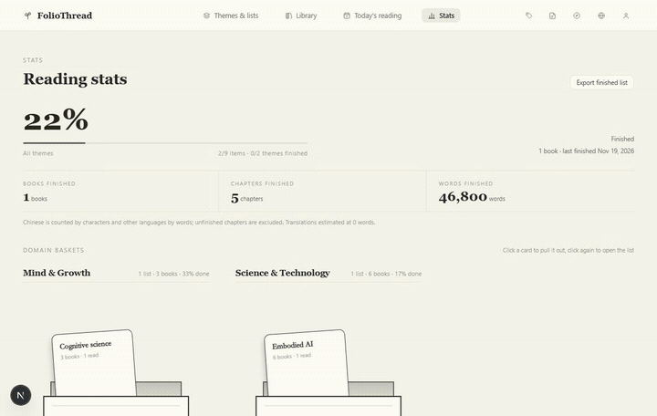

# FolioThread · 页脉研读

English · [简体中文](README.zh-CN.md)

### An AI reading planner for cross-disciplinary learners.

It is built for those who want to systematically explore one or multiple unfamiliar domains but don't know where to start. The AI curates a progressive reading list based on your goals and breaks it down into digestible daily portions that fit your time budget.

> **This is a self-hosted project with no official hosted version.** You need your own Supabase project, an LLM API key (DeepSeek or any OpenAI-compatible provider), and optionally a WeRead API key (not required for the app to function). The Quick Start below gets you running in about five minutes.

## Why this exists

In the age of AI, we often need to learn across fields quickly. Existing reading tools already handle book recommendations, immersive reading, tracking, and review well. However, what is often missing is a cohesive tool that assembles these scattered pieces into a single workflow: plan as a guide → break work into tasks → read every day. 


## Core features

- **AI reading plan**: Give it a subject and AI returns 5–6 books, ordered from easier to harder, each with a recommendation and its key concepts. Adjust the whole list in one sentence, or just swap a single book or reorder the list.
- **Private library**: Collect the EPUBs for the list yourself and upload them to your library. If you have a WeRead account and choose to configure a WeRead API key, it also provides direct links to WeRead. This saves some searching, but specialised books in some fields may not be on WeRead and still need to be found yourself.
- **Today's reading**: Using your daily budget and reading speed, it slices the uploaded books into today's chapters (hiding the rest) until the whole list is finished; several lists can progress in parallel.
- **Check-in reader**: Mark a chapter done to track progress and update the daily portion. The reader also supports AI translation for foreign-language books, audio with optional background music, and notes. However, if you have high standards for typography, FolioThread may disappoint you.
- **Domain review**: Classifies and visualises all of your reading lists by domain, so you can see every field you are exploring or have explored.

## Demo

<p align="center">
  
  
</p>
<p align="center"><sub>1 · Create a theme, AI drafts the list; list / path views　　2 · Fine-tune: reorder, swap, shelve, confirm</sub></p>

<p align="center">
  
  
</p>
<p align="center"><sub>3 · Upload an EPUB　　4 · Generate today's reading</sub></p>

<p align="center">
  
  
</p>
<p align="center"><sub>5 · Finish a chapter, move on　　6 · Review by domain in stats</sub></p>

The theme used here is “Embodied AI”. Demo data is mocked locally and belongs to no real account.

## Quick start (about 5 minutes)

### 1. Create the database (Supabase)

1. Create a new Supabase project.
2. Open **SQL Editor** and run [`database/init.sql`](database/init.sql) as one script (equivalent to running migrations `0001`→`0009` in order).
3. Open **Storage** and create a **private** bucket named exactly `shared`.
4. Open **Authentication → Providers → Email** and turn off **Confirm email** (otherwise new accounts cannot sign in right away).

### 2. Configure environment variables

```bash
cp .env.example .env.local
```

Fill in at least these three (Supabase Dashboard → Project Settings → API):

```ini
NEXT_PUBLIC_SUPABASE_URL=
NEXT_PUBLIC_SUPABASE_ANON_KEY=
SUPABASE_SERVICE_ROLE_KEY=
```

`NEXT_PUBLIC_SUPABASE_URL` must stop at the domain (`https://<ref>.supabase.co`); do not include `/rest/v1/`. All other variables are optional and degrade gracefully (see below).

### 3. Run

```bash
npm ci
npm run dev
```

Open <http://localhost:3000>, sign up, and create your first theme.

### 4. Self-check

```bash
npm run doctor                      # env vars + 13 core tables
curl "localhost:3000/api/health?db=1"   # run again while the app is up
```

`npm run doctor` tells you exactly which variable or table is missing. If tables are missing, rerun `init.sql`.

## Docker

> Optional path: CI builds the image and checks `/api/health` (after the repo is on GitHub). The author's daily deployment does not use containers; see "Local deployment" below.

```bash
cp .env.example .env    # fill in the three required values
docker compose up --build
```

Notes:

- `NEXT_PUBLIC_*` values are inlined at build time, so **changing them requires a rebuild**.
- The container health check calls `/api/health`; it reports unhealthy when required variables are missing.
- `scripts/sync-audio.mjs` generates `public/audio/` during the build, so no manual audio setup is needed.

## Local deployment

```bash
npm ci
npm run build
npm start
```

The service listens on port `3000`. For remote access, use a Tailscale domain; on a phone, add the page to the home screen to run it in a standalone window. This path does not produce `.next/standalone`, so it builds faster than the Docker route (see `next.config.mjs`).

## Optional integrations (all can be omitted)

| Variable | Behaviour when missing |
| --- | --- |
| `AI_API_KEY` (or `DEEPSEEK_API_KEY`) | Generating or regenerating a list returns **503** with no fallback; translation and theme classification stay unavailable; key-point extraction fails silently |
| `WEREAD_API_KEY` | Hides the "readable on WeRead" link and badge |
| `AZURE_SPEECH_KEY` / `AZURE_SPEECH_REGION` | Azure is skipped; speech tries Azure → local edge-tts → Baidu, then falls back to the browser voice |
| `EDGE_TTS_PYTHON` | Pin the Python interpreter used by edge-tts; otherwise it is auto-detected |
| `EDGE_TTS_DISABLED=1` | Disables local edge-tts, still trying Azure / Baidu |

### Using another LLM

Text generation goes through the OpenAI-compatible `/chat/completions` API and defaults to DeepSeek. Leave `AI_*` empty to use it, or set it explicitly:

```ini
AI_API_KEY=sk-...
AI_BASE_URL=https://api.deepseek.com/chat/completions
AI_MODEL=deepseek-flash
```

You can also switch to another OpenAI-compatible service without code changes. For example, Alibaba Cloud Model Studio (Qwen):

```ini
AI_API_KEY=sk-...
AI_BASE_URL=https://dashscope.aliyuncs.com/compatible-mode/v1/chat/completions
AI_MODEL=qwen-plus
```

Or Zhipu GLM:

```ini
AI_API_KEY=...
AI_BASE_URL=https://open.bigmodel.cn/api/paas/v4/chat/completions
AI_MODEL=glm-4-flash
```

Moonshot Kimi, SiliconFlow, Volcengine Ark, and local Ollama / vLLM work the same way: fill in their compatible URL and model name (check each provider's console). When using a custom URL, also set `AI_MODEL`; otherwise it falls back to the DeepSeek default model. The old `DEEPSEEK_API_KEY` / `DEEPSEEK_BASE_URL` variables still work.

OpenAI direct access is unavailable on some networks; Claude's native API uses a different protocol and needs a gateway such as OpenRouter or LiteLLM. Neither is required.

## Background music (optional)

The repository ships no third-party music. Audio mode picks background sound in this order:

1. `background-music/rain-loop.mp3` and `background-music/piano-loop.mp3` (bring your own; ignored by `.gitignore`);
2. otherwise the CC0 synthetic loops in `assets/audio-fallback/`, generated by `scripts/make_audio.py`.

To use your own tracks, drop them into `background-music/` under those two file names; `npm run dev` / `npm run build` syncs them into `public/audio`. The Pixabay tracks and licence notes used by the author are in [NOTICE](NOTICE).

### What you hear by default

**A fresh clone or self-hosted deployment hears the CC0 synthetic loops in `assets/audio-fallback/`** (filtered noise for rain, synthesized notes for piano), not the two real recordings below. See [NOTICE](NOTICE) 2.1: the Pixabay licence does not allow redistributing the original audio, so they are not in the repository and exist only on the author's machine.

### Tracks used by the author (optional, download yourself)

To switch to the author's two tracks, search Pixabay by ID, download, and place them under the file names below:

| File name | Track | Artist | Pixabay ID |
| --- | --- | --- | --- |
| `piano-loop.mp3` | Gymnopédie No. 1 | Erik Satie (performed by abydos_music) | 176573 |
| `rain-loop.mp3` | Sleep Well (Rainy Toasted White Noise Mix) | gingerleegalaxy | 229397 |

Everything works without them; you will just hear the synthetic loops. Licences follow the Pixabay Content Licence.

## Bring your own books

The repository contains **no book text or covers**. Imported EPUBs are written only to your own Supabase project and Storage. You can import from the UI, or use:

```bash
npm run import -- ./path/to/book.epub
```

## Account and deletion

- Accounts belong to the Supabase project of the current deployment; email and password are managed by Supabase Auth.
- The avatar menu in the top bar → Account shows the signed-in email and can delete the whole account. Deletion also removes that account's books and EPUB files, notes, themes and lists, and reading progress. It cannot be undone.
- There is no admin console in the app; deployers can still delete users from the Supabase dashboard.

## Known limitations

- Rate limiting is in-process and only effective for a single instance; multi-instance deployments need external storage.
- The app does not back up the database; backup and restore are the deployer's responsibility.
- AI-generated lists, translations, and key points may be wrong — use your own judgement.

## How this was built

This is a vibe-coding project. The human side covered the product direction, information architecture, visual design, copy, acceptance criteria and real-device testing; the implementation — most of the TypeScript/React code, styles, i18n dictionaries and Playwright mock harness — was written with AI assistants under that direction.

Every change is checked with `tsc`, `next build` and the HTTP smoke suite before release. AI-assisted code can still hide bugs: if something looks off, please open an issue or a PR — review and corrections are especially welcome.

## License

Code is released under MIT; see [LICENSE](LICENSE). Third-party background music is not included; sources and licences are in [NOTICE](NOTICE). The fallback audio in the repository is synthesized by `scripts/make_audio.py` and released under CC0.

The MIT licence covers the source code only. It does not grant rights to the "FolioThread" / "页脉研读" names, logo or icons. Forks and modified versions are welcome — please use your own name and branding, and do not present a modified version as the official project.

Release history: [CHANGELOG.md](CHANGELOG.md). Security policy: [SECURITY.md](SECURITY.md).
